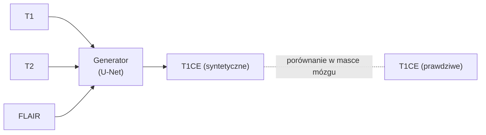
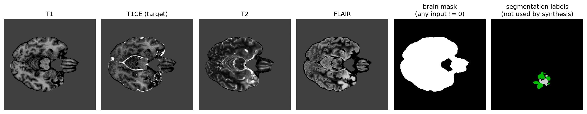
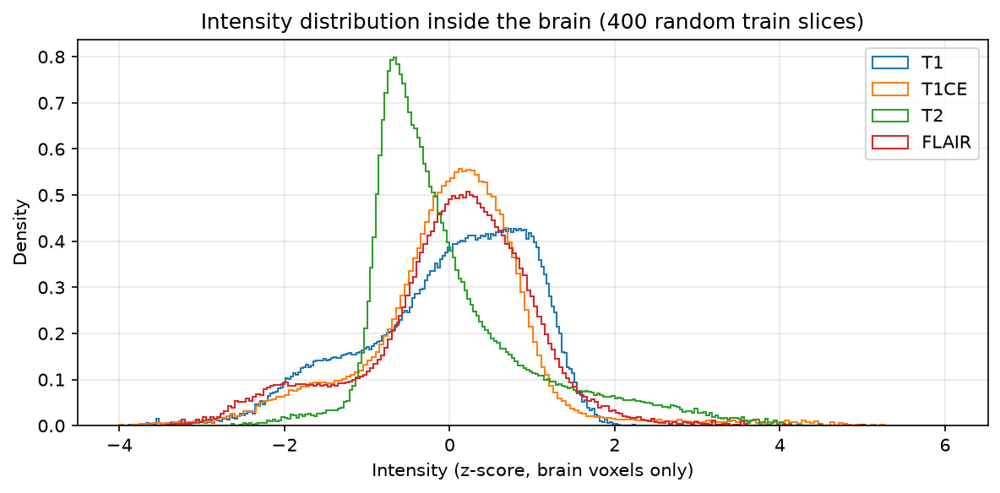
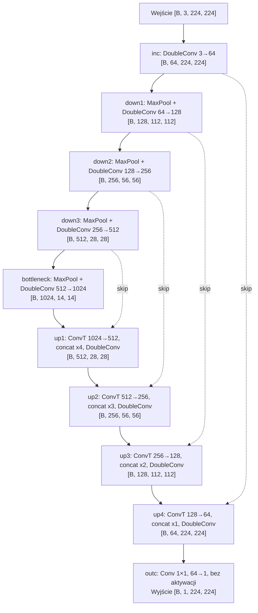
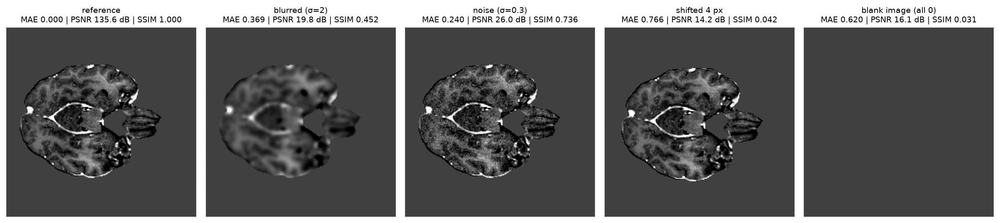

# Synteza brakujących modalności MRI

Opis pipeline'u z notebooka [04_modality_synthesis.ipynb](../notebooks/04_modality_synthesis.ipynb): zadanie, dane, architektura, funkcja straty, metryki i trening. Wzory używają składni LaTeX (renderuje je podgląd Markdown w VS Code i GitHub).

## 1. Zadanie

W praktyce klinicznej zdarza się, że brakuje jednej sekwencji MRI (np. T1CE, bo nie podano kontrastu). Model dostaje trzy dostępne modalności i ma wygenerować czwartą, brakującą.

Uczenie jest nadzorowane na pełnych danych. Ukrywamy jedną modalność, sieć ją zgaduje, a prawdziwy obraz służy jako wzorzec. Pierwszy eksperyment: `TARGET = "T1CE"`. Inne modalności zmienia się zmienną `TARGET`, za każdym razem trenując osobny model.

## 2. Dane

- Slice'y 2D o rozmiarze 224 × 224, 4 kanały w kolejności **T1, T1CE, T2, FLAIR** (kolejność z [data_config.yaml](../configs/data_config.yaml)).
- Preprocessing (osobno dla każdej modalności i pacjenta): przycięcie do percentyli 1–99 w mózgu, potem **z-score w mózgu**. Tło ma dokładnie wartość 0.
- Pliki `.pt` na dysku się nie zmieniają. Synteza i segmentacja czytają te same pliki. `ModalitySynthesisDataset` ([dataset.py](../src/brain_mri/data/dataset.py)) rozdziela kanały dopiero przy wczytywaniu.

Dataset zwraca trzy tensory:

| Tensor | Kształt | Zawartość |
|---|---|---|
| wejście | (3, 224, 224) | trzy pozostałe modalności, w oryginalnej kolejności |
| target | (1, 224, 224) | modalność do wygenerowania |
| maska mózgu | (1, 224, 224) | 1 tam, gdzie któryś kanał wejściowy ≠ 0 |

*Rys. 1. Przykładowy slice. Cztery modalności, maska mózgu wyliczona z wejść oraz maska segmentacji, której synteza nie używa.*

### Dlaczego potrzebna jest maska mózgu

Po z-score tło (0) leży w środku zakresu wartości mózgu, więc nie da się go odfiltrować warunkiem `image > 0`. Ścisłe zero wewnątrz mózgu jest praktycznie niemożliwe, dlatego `image != 0` wydziela mózg poprawnie.

Maska jest potrzebna, bo tło to większość obrazu i jest trywialne do odtworzenia. Na przykładowym slice'ie mózg zajmuje około 30% pikseli. Dla tego samego rozmytego obrazu błąd bezwzględny wynosi 0.11 na całym obrazie i 0.37 w samym mózgu. Liczenie na całym obrazie zaniżałoby błąd około trzykrotnie.

### Zakres wartości

*Rys. 2. Rozkład intensywności w mózgu (400 losowych slice'ów train).*

Zmierzone zakresy wartości w mózgu:

| Modalność | min | 0.1 percentyl | 99.9 percentyl | max |
|---|---|---|---|---|
| T1 | −3.90 | −3.55 | 1.90 | 2.25 |
| T1CE | −4.00 | −3.58 | 4.73 | 6.02 |
| T2 | −2.64 | −2.33 | 3.97 | 4.50 |
| FLAIR | −3.59 | −3.20 | 3.52 | 5.03 |

Zakres jest nieograniczony i różni się między modalnościami. T1CE ma długi prawy ogon (jasne naczynia i wzmacniający się guz). To uzasadnia **liniowe wyjście generatora** (bez `sigmoid` i `tanh`).

## 3. Architektura generatora

`Unet_Generator` ([unet_generator.py](../src/brain_mri/models/unet_generator.py)) dziedziczy po `UNet` z segmentacji. Parametry: **31.0 M**, `base_features = 64`.

`DoubleConv` to dwa razy (Conv 3×3 → BatchNorm → ReLU).

Różnice względem U-Netu do segmentacji dotyczą tylko pierwszej i ostatniej warstwy oraz sposobu liczenia błędu:

| | U-Net (segmentacja) | Unet_Generator |
|---|---|---|
| Kanały wejściowe | 4 | 3 |
| Kanały wyjściowe | 5 (klasy) | 1 (intensywność) |
| Aktywacja końcowa | brak, potem softmax w lossie | brak (liniowe wyjście) |
| Loss | Dice + CrossEntropy | masked L1 + (1 − SSIM) |
| Metryki | Dice na klasę | SSIM, PSNR, MAE |

Skip connections przenoszą szczegóły z enkodera do dekodera. Bez nich wynik byłby jeszcze bardziej rozmyty.

## 4. Funkcja straty: `MaskedL1SSIMLoss`

Implementacja w [losses.py](../src/brain_mri/models/losses.py). Wszystkie sumy są po pikselach, dla których maska $M = 1$.

$$\mathcal{L} = w_1 \cdot \mathrm{L1} + w_2 \cdot (1 - \mathrm{SSIM}), \qquad w_1 = w_2 = 1$$

**L1 (średni błąd bezwzględny w mózgu):**

$$\mathrm{L1} = \frac{\sum_{i} M_i\,|\hat{y}_i - y_i|}{\sum_i M_i}$$

gdzie $\hat{y}$ to obraz wygenerowany, a $y$ prawdziwy. L1 jest stabilny, ale sam prowadzi do rozmytych wyników: przy niepewności sieć wybiera średnią możliwych wartości.

**SSIM (Structural Similarity):**

$$\mathrm{SSIM}(x,y) = \frac{(2\mu_x\mu_y + C_1)(2\sigma_{xy} + C_2)}{(\mu_x^2+\mu_y^2 + C_1)(\sigma_x^2+\sigma_y^2 + C_2)}$$

- $\mu$, $\sigma^2$, $\sigma_{xy}$ to lokalna średnia, wariancja i kowariancja liczone w oknie gaussowskim 11×11 ($\sigma = 1.5$).
- $C_1 = (0.01\,L)^2$ i $C_2 = (0.03\,L)^2$ stabilizują dzielenie. $L$ to `data_range` (w kodzie 6.0).
- Wartość od −1 do 1: 1 to obrazy identyczne, 0 brak związku strukturalnego.
- Mapa SSIM jest uśredniana po pikselach mózgu. Piksele tła nie wchodzą do średniej, ale okno przy brzegu mózgu nadal widzi sąsiednie tło.
- SSIM zachowuje krawędzie i teksturę, które sam L1 rozmywa. Dlatego loss ma obie składowe.

## 5. Metryki walidacyjne

Wszystkie liczone w masce mózgu ([synthesis_trainer.py](../src/brain_mri/training/synthesis_trainer.py)).

| Metryka | Wzór | Kierunek | Co mierzy |
|---|---|---|---|
| **SSIM** | jak w pkt. 4 | wyżej = lepiej, max 1 | podobieństwo struktury, wg niej wybierany jest najlepszy checkpoint |
| **PSNR** | $10\log_{10}\!\left(L^2 / \mathrm{MSE}\right)$ | wyżej = lepiej | stosunek szczytowej wartości do błędu kwadratowego (dB) |
| **MAE** | jak L1 w pkt. 4 | niżej = lepiej | średni błąd w jednostkach z-score |

$$\mathrm{MSE} = \frac{\sum_i M_i\,(\hat{y}_i - y_i)^2}{\sum_i M_i}$$

PSNR silniej karze duże błędy niż MAE (kwadrat). Jego wartość zależy od przyjętego $L$ (`data_range`), więc porównuj tylko wartości policzone z tym samym $L$.

### Jak metryki reagują na typowe zniekształcenia

*Rys. 3. Ten sam prawdziwy slice T1CE i cztery zniekształcone wersje, z metrykami policzonymi tym samym kodem co w treningu.*

| Wersja | MAE | PSNR [dB] | SSIM |
|---|---|---|---|
| oryginał | 0.000 | (∞, w demo 135.6) | 1.000 |
| rozmycie (σ = 2) | 0.369 | 19.8 | 0.452 |
| szum (σ = 0.3) | 0.240 | 26.0 | 0.736 |
| przesunięcie o 4 px | 0.766 | 14.2 | 0.042 |
| pusty obraz (same 0) | 0.620 | 16.1 | 0.031 |

Wnioski z tego zestawienia:
- Przesunięcie o 4 piksele daje SSIM prawie 0, mimo że obraz wygląda ostro i podobnie. SSIM jest bardzo czuły na przesunięcia struktur.
- Pusty obraz (zero informacji) ma MAE 0.62, czyli lepsze niż przesunięty, wiarygodnie wyglądający obraz (0.77). MAE i PSNR nagradzają „bezpieczne” wartości, a SSIM w obu przypadkach jest bliskie 0. Dlatego raportujemy wszystkie trzy metryki.
- Rozmycie ma umiarkowane MAE, ale wyraźnie obniża SSIM. To jest typowy błąd generatora uczonego samym L1.

## 6. Trening

| Element | Ustawienie |
|---|---|
| Optymalizator | AdamW, lr = 1e-4, weight decay = 1e-5 |
| Harmonogram | CosineAnnealing, lr: 1e-4 → 1e-6 w 30 epokach |
| Batch | 32 (przy braku pamięci GPU zmniejsz do 16) |
| Precyzja | bf16 autocast na GPU, loss liczony w float32 |
| Checkpoint | `checkpoints/best_generator_<target>.pt`, zapisywany, gdy val SSIM jest najlepsze dotąd |
| Test | jednokrotnie na zbiorze test, na najlepszym checkpoincie |

Podział train / validate / test jest ten sam (`processed_no_leaks`) co w segmentacji. Pacjenci nie przeciekają między zbiorami.

## 7. Ograniczenia i znane uproszczenia

1. **`data_range = 6.0` jest zaniżone.** Z pomiarów (pkt. 2) zakres T1CE od 0.1 do 99.9 percentyla to około 8.3, a pełny zakres danych to około 10. Wartość 6.0 wpływa na PSNR i stałe $C_1$, $C_2$ w SSIM. Przed raportowaniem wyników do pracy ustaw jedną, uzasadnioną wartość, np. około 8, i trzymaj ją we wszystkich eksperymentach.
2. **Walidacyjny SSIM** to średnia ze średnich po batchach, a PSNR i MAE są liczone globalnie po pikselach. Różnica jest mała, ale warto o niej wspomnieć w opisie metodyki.
3. **Maska mózgu pochodzi z wejść**, więc nie obejmuje pikseli, które są niezerowe tylko w modalności docelowej. W praktyce rzadko się to zdarza.
4. **Dobre metryki obrazowe nie gwarantują wiarygodności klinicznej.** Odtworzenie wzmocnienia guza w T1CE jest trudne. Kluczowe jest drugie sprawdzenie: Dice segmentacji na obrazach z wygenerowaną modalnością, w porównaniu z baseline'ami (zera zamiast brakującej modalności, segmentacja uczona z losowym wyzerowaniem modalności, pełne 4 modalności).
5. Wynik L1 + SSIM będzie rozmyty. Naturalnym następnym krokiem jest pix2pix (generator + dyskryminator PatchGAN).

## 8. Pliki

| Plik | Rola |
|---|---|
| [dataset.py](../src/brain_mri/data/dataset.py) | `ModalitySynthesisDataset`, `create_dataloader(..., target_modality=...)` |
| [unet_generator.py](../src/brain_mri/models/unet_generator.py) | `Unet_Generator` |
| [losses.py](../src/brain_mri/models/losses.py) | `masked_ssim`, `MaskedL1SSIMLoss` |
| [synthesis_trainer.py](../src/brain_mri/training/synthesis_trainer.py) | `SynthesisTrainer` (trening, walidacja, checkpoint) |
| [04_modality_synthesis.ipynb](../notebooks/04_modality_synthesis.ipynb) | uruchomienie eksperymentu |
